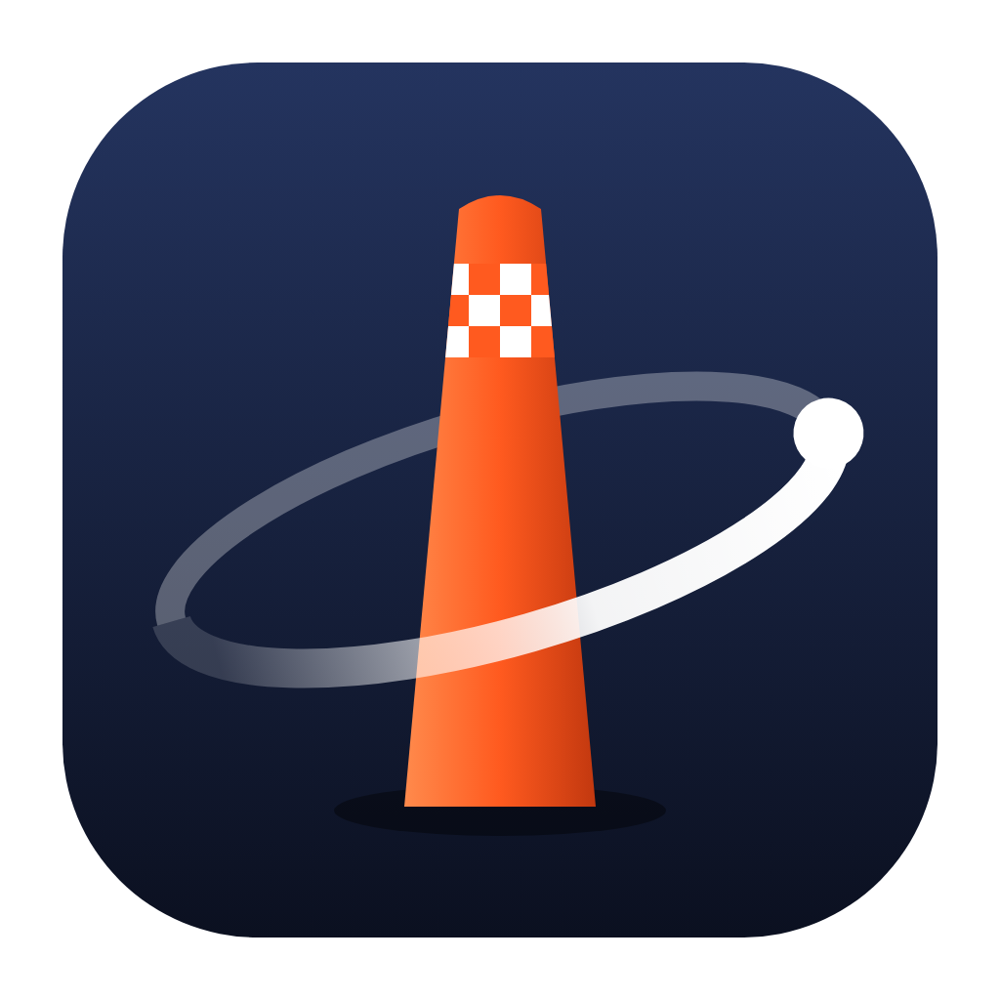
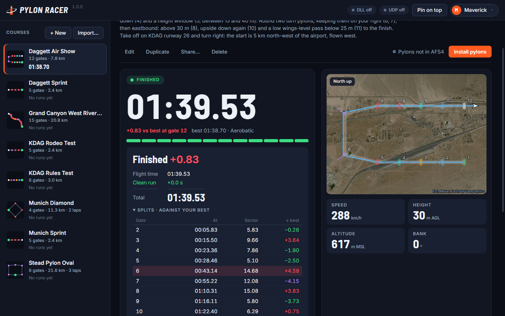
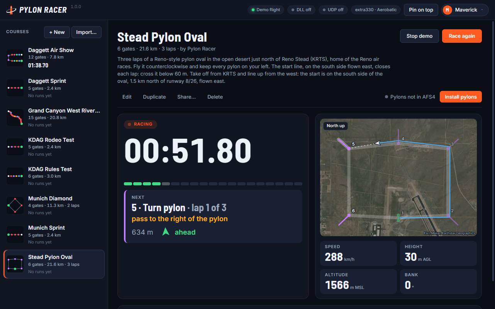
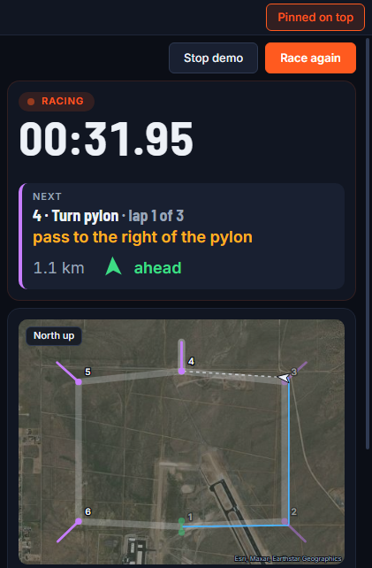
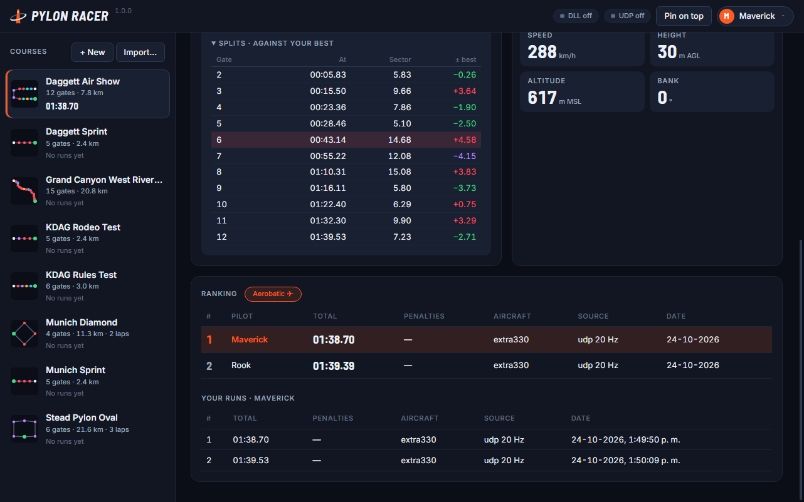
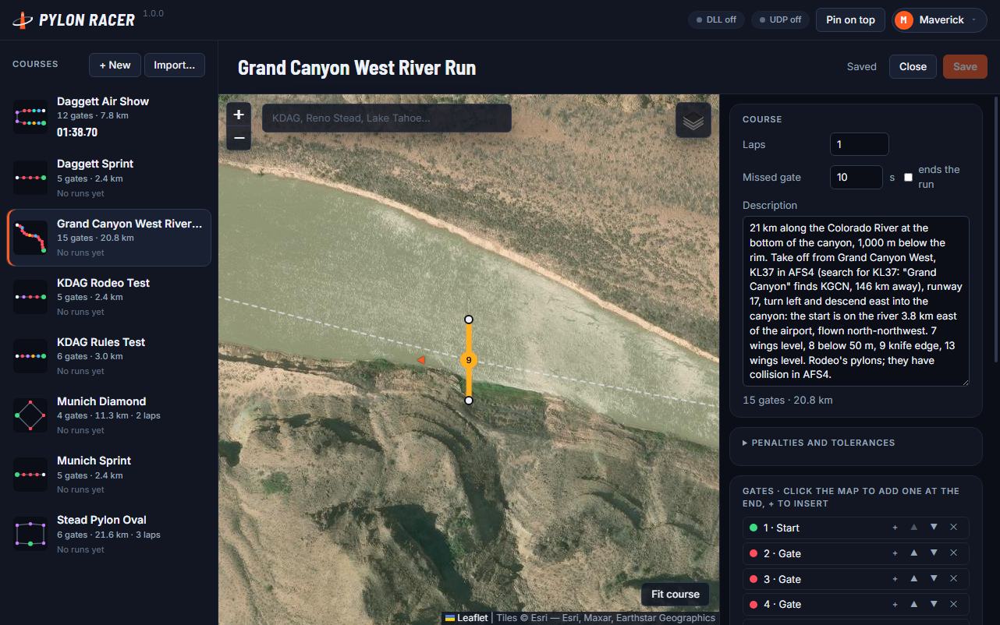

<p align="center"></p>

# Pylon Racer

Pylon racing for **Aerofly FS 4**. Pick a course, fly through its gates in order and race the clock:
Pylon Racer follows your flight live, times every gate, applies the rules and keeps your runs. Design
your own courses on a satellite map, install their pylons in the simulator with one click, and share
them with other pilots as a file.



**[Download for Windows, macOS or Linux](https://github.com/jlgabriel/afs4-pylon-racer/releases/latest)**

## Get started

1. **Install Pylon Racer** from the [latest release](https://github.com/jlgabriel/afs4-pylon-racer/releases/latest)
   (see [Installing](#installing) for the security prompts).
2. **Connect Aerofly FS 4**: in AFS4's settings, turn on the flight-info broadcast to the network
   (port **49002**). On Windows you can also add the optional AeroflyReader plug-in for smoother data
   (see [Connecting to Aerofly FS 4](#connecting-to-aerofly-fs-4)).
3. **Pick a course** on the left and click **Install pylons**. Restart Aerofly FS 4 to see them.
4. **Fly.** The course's description says where to take off. The race arms itself and starts when you
   fly through the start gate in the right direction. A checklist under the timer says what is still
   missing (flight data, pylons, your aircraft's class) and where the start is.
5. **Fly the gates in order.** Your run is saved at the finish. **Race again** arms a new attempt.

Want to see it first? **Watch demo** flies any course for you, no simulator needed.

## Courses included

| Course | Where | What it asks |
|--------|-------|--------------|
| **Grand Canyon West River Run** | Grand Canyon West, **KL37** in AFS4 | 21 km along the Colorado River, 1,000 m below the rim, by Jugac64 |
| **Stead Pylon Oval** | Reno Stead, **KRTS** | Three laps of a Reno-style oval, every pylon on your left |
| **Daggett Air Show** | Daggett, **KDAG** | Wings level, knife edge, inverted, a height window and turn pylons |
| **Daggett Sprint** | Daggett, **KDAG** | Five gates in a straight line: the quickest way to learn |
| **KDAG Rules Test** | Daggett, **KDAG** | One gate of each classic kind |
| **KDAG Rodeo Test** | Daggett, **KDAG** | Rodeo's three pylon models |
| **Munich Sprint** / **Munich Diamond** | Munich, **EDDM** | A straight sprint, and two laps of a diamond |

In AFS4, search for Grand Canyon West as **KL37**: "Grand Canyon" finds KGCN (Tusayan), 146 km away.

## Racing



- **Live race screen**: race time, the delta to your best at each gate, the gate strip, the next gate
  with what it asks for and which way to turn ("35° left"), a course map over satellite imagery with
  your trail, and speed, height, altitude and bank.
- **Splits**: the result shows the time between every two gates against the same stretch of your best,
  so you can see where you won or lost time.
- **Multi-lap courses**: the start line closes each lap; lap times are shown at the finish.
- **Gate detection that does not depend on the update rate**: a pass is found by crossing the gate line
  between two samples, and its instant is interpolated, so times stay accurate even with the ~5 Hz UDP
  feed.
- **Crashing or pausing ends the race** as *Did not finish*, with the clock stopped at that moment
  (pylons have collision in AFS4).
- **Demo flights** never count for the ranking.

### Flying with one monitor

**Pin on top** keeps Pylon Racer above the simulator (run AFS4 windowed or borderless). Make the window
narrow and it shows only what you need while flying: the timer, the next gate with its turn arrow, the
map and the values.



### The rules

| Gate | How to pass it |
|------|----------------|
| **Start** / **Finish** | Between the pylons, in the course's direction. The start starts the clock |
| **Gate** | Between the pylons, in the course's direction |
| **Level gate** | With the wings level (±10° of bank) |
| **Knife-edge gate** | On a wing (90° of bank, ±15°) |
| **Inverted gate** | Upside down (180° of bank, ±20°) |
| **Turn pylon** | A single pylon: fly around it on the side the course says |

Any gate can also have a **ceiling**, a **floor**, or both (a height window), measured above the ground.

| Penalty | Default |
|---------|---------|
| Missed gate | +10 s (or the run ends, if the course says so) |
| Wrong direction | +10 s |
| Wrong attitude (level, knife edge, inverted) | +2 s |
| Too high / too low | +2 s |
| Pylon hit (closer than 5 m, below its top) | +3 s |
| Turn pylon cut | +10 s |

Every course can change its penalties and tolerances. The result lists each penalty with what was
measured ("Gate 2 · wings not level: bank 17°").

## Pilots and rankings



- **Ranking per course and aircraft class** (aerobatic, vintage and warbird, general aviation, jet,
  helicopter, glider…), one row per pilot with their best run. You race against your own best in the
  class of the aircraft you fly.
- **Several pilots on one computer**: click the callsign in the top bar to switch pilots, add one or
  remove one (their runs are kept). A run belongs to whoever crossed the start line.
- With the AeroflyReader plug-in Pylon Racer knows your aircraft. With UDP only, or with an aircraft it
  does not know, pick the class in the top bar; it is remembered.
- **Changing a course's gates or rules starts a new ranking** for it, so times are only ever compared
  on the same course.

## Design your own courses



- **Course designer on a satellite map**: search for an airport or a place, click to place gates, drag
  a gate to move it, drag its arrow to turn it, drag a pylon to make it wider or narrower.
- **+** in the gate list inserts a gate halfway between two; **Align** turns a gate halfway between the
  legs in and out, so neither turn is too tight.
- **Gate kinds**, **laps**, **height limits**, the **pylon model** of each gate and the course's
  **penalties and tolerances**.
- The terrain elevation of every gate is looked up when you save, so the height rules also work with
  the UDP feed, which only gives the altitude above sea level.
- **Install pylons in Aerofly FS 4 with one click**, and remove them the same way. Pylon Racer only
  ever touches the scenery folders it created. Restart AFS4 after installing.

## Sharing

There is no server: courses travel as files, through the forum or however you like. Your runs stay
on your computer.

- **Share…** on a course saves a `.pylonrace` file. The pylons are not inside: the app installs them
  on the other pilot's computer.
- To open one, use **Import…**, drop it on the window, or double-click it (installed app).
- **Import…** also takes courses made with the earlier pylon-race web editor (`course.json`).

## Connecting to Aerofly FS 4

Pylon Racer reads your flight from one of two sources and uses the best one available:

| Source | Systems | Rate | Extras |
|--------|---------|------|--------|
| **UDP broadcast** (built into AFS4) | Windows, macOS, Linux | ~5 Hz | — |
| **AeroflyReader.dll** ([Aerofly-FS4-Bridge](https://github.com/jlgabriel/Aerofly-FS4-Bridge), `simplified/`) | Windows | ~40 Hz | height above ground, the aircraft |

**UDP:** in AFS4's settings, turn on the flight-info broadcast to the network, port **49002**.

**AeroflyReader.dll (optional, Windows):** download `AeroflyReader.zip` from the
[Releases](https://github.com/jlgabriel/afs4-pylon-racer/releases) page (next to the installers),
copy `AeroflyReader.dll` into `Documents\Aerofly FS 4\external_dll\` (create the folder if it is not
there) and restart AFS4.

The top bar shows which source is live and at what rate.

## Installing

| System | File |
|--------|------|
| Windows | `afs4-pylon-racer-<version>-setup.exe` (installer) or `-portable.exe` |
| macOS (Apple silicon / Intel) | `afs4-pylon-racer-<version>-arm64.dmg` / `-x64.dmg` |
| Linux | `afs4-pylon-racer-<version>.AppImage` |

The builds are not signed with a paid certificate:

- **Windows**: if SmartScreen appears, click *More info* → *Run anyway*.
- **macOS**: the first time, macOS says it could not verify the app. Open *System Settings* →
  *Privacy & Security* and click *Open Anyway*.
- **Linux**: make the AppImage executable (`chmod +x`) and run it.

## Troubleshooting

- **"Waiting for Aerofly FS 4…" while flying.** Check the broadcast setting and port 49002 in AFS4,
  and that your firewall lets Pylon Racer receive on the local network. With the plug-in, check that
  `AeroflyReader.dll` is in `Documents\Aerofly FS 4\external_dll\` and that you restarted AFS4.
- **I don't see the pylons.** Install them from the course, then restart AFS4: it only loads scenery
  at start-up. If the course says *Pylons in AFS4 are out of date*, reinstall them.
- **Pylon Racer can't find my AFS4 folder** (for example, Documents moved to OneDrive). It tells you so
  when you install pylons and lets you choose the folder.
- **I can't see the app while flying.** Use *Pin on top* and run AFS4 windowed or borderless.
- **My time didn't count.** Demo flights never rank, and each course ranks per aircraft class: check
  the class tabs above the ranking.

## Building from source

Requires Node 24.

```bash
npm install
npm run dev            # run the app
npm run typecheck      # both tsconfigs
npm test               # unit tests
npm run test:e2e       # builds, then drives the Electron app
npm run build:win      # or build:mac / build:linux
```

`npm run preview:renderer` serves the interface alone in a browser; open it with `?mockracer` to race
demo flights without Electron. `npm run icons` renders the icons from `resources/*.svg`, and
`scripts/screenshots.cjs` takes the screenshots above.

## License and credits

GPL-3.0-or-later. See [LICENSE](LICENSE).

Pylon Racer ships no Aerofly FS 4 content. The pylon models are krzysk1's Reno air-race pylons (MIT)
and Rodeo's air-race pylons (used with permission); the fonts are Inter and Barlow Semi Condensed (SIL
Open Font License). See [THIRD_PARTY_NOTICES.md](THIRD_PARTY_NOTICES.md).
